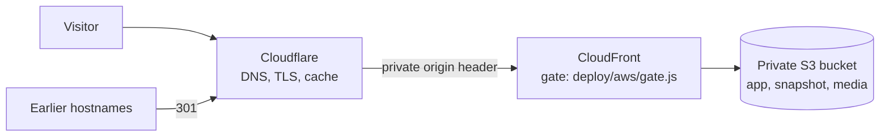

# Deploying Starwatch

The public app runs at [starwatch.danielvecera.com](https://starwatch.danielvecera.com). Every page, the snapshot and the media are open to everyone; there are no accounts and no sign-in. The earlier hostnames `starwatch.agenticanalytics.cz` and the jury preview redirect to it.



- **Cloudflare** terminates TLS, caches static files with its default rules (HTML is not cached at the edge, so a deploy shows up at once), and adds a private origin header through a Transform Rule. A Configuration Rule enforces strict TLS to CloudFront. Single Redirects send the earlier hostnames to the current one with the path and query string kept.
- **CloudFront Function (`deploy/aws/gate.js`)** accepts only requests that carry the origin header, so the CloudFront hostname cannot be used to bypass Cloudflare. It maps `/` to the welcome page and sends the retired sign-in paths (`/login`, `/auth/*`, `/data-deletion`) home. Media byte ranges pass through untouched, so video seeks work.
- **S3** stays private; only the distribution can read it.

## Run it

Copy `config.example.json` outside the repository and fill in your own account handles. Credentials come from environment variables: AWS (standard boto3 variables) and Cloudflare (`CLOUDFLARE_API_TOKEN`, or a global key with `CLOUDFLARE_GLOBAL_API_KEY` and `CLOUDFLARE_EMAIL`).

```sh
node --test deploy/aws/gate.test.mjs
uv run --with boto3 python deploy/launch.py --config ../starwatch-deploy.json keys cert cloudflare cloudfront redirects site verify
```

Each step is idempotent:

| Step | What it does |
| --- | --- |
| `keys` | Creates the private origin key in AWS Secrets Manager once. |
| `cert` | Requests the CloudFront certificate for `host` and validates it through a DNS record in the Cloudflare zone. |
| `cloudflare` | Points `host` at CloudFront (proxied) and sets the origin-header and strict-TLS rules. |
| `cloudfront` | Publishes the gate, makes `host` the distribution's only alias with the new certificate, and keeps responses cacheable and indexable (no `private, no-store` or `noindex` headers). |
| `redirects` | Adds a 301 for every `redirect_hosts` entry, removes their Worker routes, Starwatch rules and Access applications, and deletes the Workers listed in `retire_workers`. |
| `site` | Uploads changed files (SHA-256 in object metadata), removes `retire` paths and invalidates them. `media/` is uploaded separately once. |
| `verify` | Checks that every page and data file is public, the retired sign-in paths redirect, direct CloudFront access is refused, video ranges work and each earlier hostname redirects. |

Run `cloudflare` before `cloudfront` when moving to a new hostname, and `redirects` right after it: once the alias moves, the old hostname only works through its redirect.
